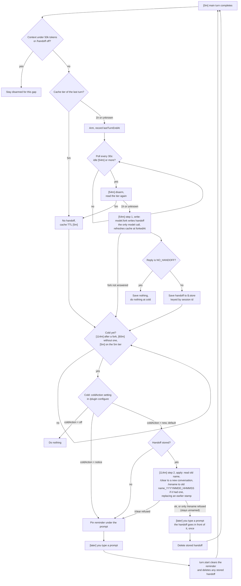

# cache-handoff flow

How the mod behaves across one idle gap on the main session, with `coldAction` at its default, `new`. Times count from the end of the last turn and assume the 1h cache tier, except the lines marked 5m.

Status: 0.4.2 is implemented in `hooks/register.ts` and passes its mock tests.

Live checks:

- 2026-10-14, with a throwaway probe mod (since removed from the repo): `$.command.run` ran `/clear` and then `/rename` from a timer while the session was idle; the timer kept running under the new session id; `grep` was on PATH and read the old title; after `/clear` only the `SessionStart:clear` hooks ran, and the memory `session-start.js` did not; a cross-session peer message did not take the carried text.
- 2026-10-15, a real session on 0.4.0: the last turn ended about 11:10, the handoff was written at 12:04 ([54m]), `/clear` and `/rename` ran at 13:04 ([114m]), and the first prompt typed at 13:23 opened with the `<handoff>` block. Every step of the timeline has now run live.

## Timeline

```
 [0m]      last turn ends            mod records the time, reads the cache tier, arms
                                     under 50k context tokens or /handoff off: sits out this gap
                                     5m cache tier: no handoff for this gap
 [5m]      5m tier only              pin "cache cold, /clear first" reminder
                                     (unless coldAction is off)
 [54m]     step 1: write             fork writes the handoff over the warm cache
                                     (the only model call; it also refreshes the cache
                                     for another 1h; the conversation is unchanged)
                                     reply NO_HANDOFF: nothing saved, nothing at cold
                                     otherwise: handoff saved to $.store under the session id
 [114m]    step 2: apply (new)       read the old conversation's name
                                     /clear  ->  new conversation
                                     /rename "<old name>_YYYYMMDD_HHMMSS" if it had a name
                                     (a stamp from an earlier handoff is replaced, not stacked)
                                     status line: new conversation from the handoff
 [later]   you type a prompt         prompt = <handoff> + resume line + your text, once
                                     stored handoff deleted
                                     only the system prompt, tools and handoff get cached;
                                     the old conversation stays whole for claude --resume
```

Any new turn in the old conversation before [114m] deletes the stored handoff, and the next idle gap starts over. That includes a turn started by a finished background task or a message from another session, not only a prompt you type.

## Write once, apply later

The handoff is written once, at step 1, by a fork that reads the warm cache. Step 2 makes no model call: it opens a new conversation and puts the text step 1 already wrote in front of your first prompt there.

The two steps are apart on purpose. Between [54m] and [114m] the cache is still warm, so coming back then continues the full conversation at the cheap price with every detail kept. The mod switches to a new conversation only at cold, when continuing the old one would mean re-caching the whole transcript.

Nothing is lost by the switch: the old conversation is left as it was, and `claude --resume <old id>` opens it with every detail.

## Decision flow



## The /handoff command

| Command | Effect |
| --- | --- |
| `/handoff off` | Disarm the mod for this session. |
| `/handoff on` | Arm it again from the next turn. |
| `/handoff now` | Open the new conversation from the stored handoff right away. This also covers a session resumed with `claude --resume` after Claude Code was closed before the cache went cold. |

## Settings

| Name | Where | Default | Purpose |
| --- | --- | --- | --- |
| `coldAction` | `/plugin configure` | `new` | When the cache goes cold: `new` opens a new conversation from the handoff, named `<old name>_YYYYMMDD_HHMMSS`, and leaves the old one whole for `claude --resume`; `notice` pins a reminder; `off` does nothing at cold, though the [54m] handoff is still written (one model call) and stays stored for `/handoff now` until your next turn. |
| `CACHE_HANDOFF_TTL_MIN` | environment | 60 | Cache TTL in minutes, shortened for live tests. |
| `CACHE_HANDOFF_LEAD_MIN` | environment | 6 | Minutes before cold at which the handoff is written. |

## What each step touches

| Step | Mod API | External |
| --- | --- | --- |
| Arm and track idle | `turn.complete`, `turn.start` hooks, `$.clock.every` | none |
| Context threshold | `$.session.usage()` | none |
| Find cache tier, at turn end and again at [54m] | `$.process.run(['tail', ...])`, else `$.fs.read` | session transcript `.jsonl`, its path from `classic.Stop` or derived from the cwd and session id |
| Write handoff | `$.model.fork` | none |
| Keep handoff | `$.store` | none, local to Claude Code |
| Read old name | `$.process.run(['grep', ...])` | transcript `custom-title` rows |
| New conversation | `$.command.run` for `clear` and `rename` | none |
| Carry the handoff | `prompt.submit` hook, typed prompts only | none |
| Command | `$.command.register`, `command.run` hook | none |
| Reminder | `$.ui.status`, `$.ui.toast` | none |

## Limits

- Runs only while Claude Code stays open; timers stop on exit. A handoff stored before exit waits for `/handoff now` in the resumed session, and a stored handoff nobody comes back for is dropped after 7 days.
- If the 5m tier only shows in the transcript at [54m] (the turn ended before its cache write was saved), the reminder comes at [54m] instead of [5m].
- The handoff is no longer sent to mcp-memory-service, so `session-start.js` and other providers (Codex, opencode, Gemini) do not see it.
- The new conversation starts without the old one's session state: its todo list, permissions granted during the session, and background tasks.
- Only a prompt typed in the composer takes the handoff; messages from other sessions and plugin prompts pass through unchanged.
- If `/clear` is refused, the mod falls back to the notice, and the stored handoff waits for `/handoff now`. If only `/rename` is refused, the new conversation stays unnamed and your next prompt still carries the handoff.
